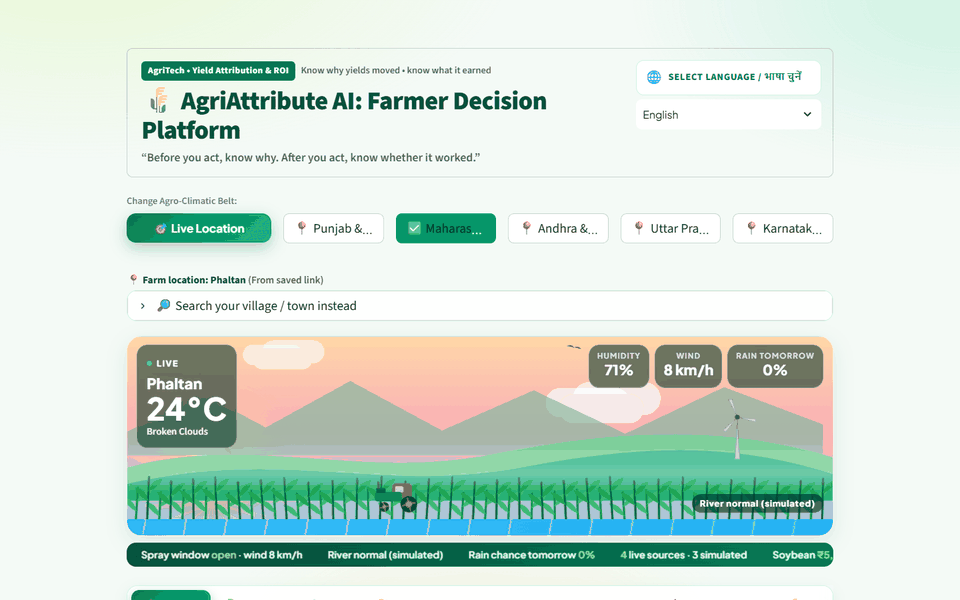
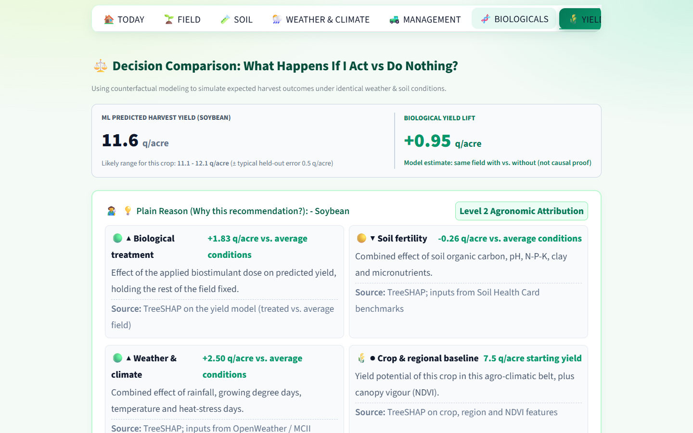
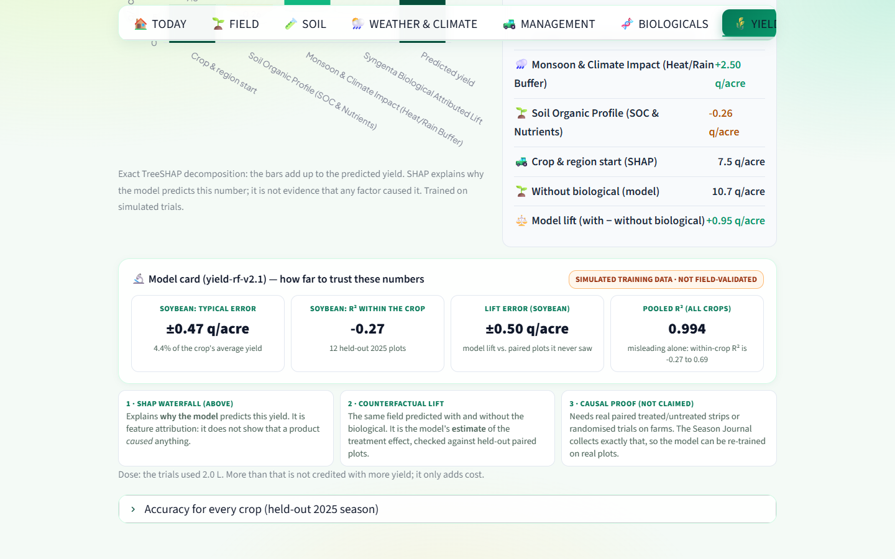
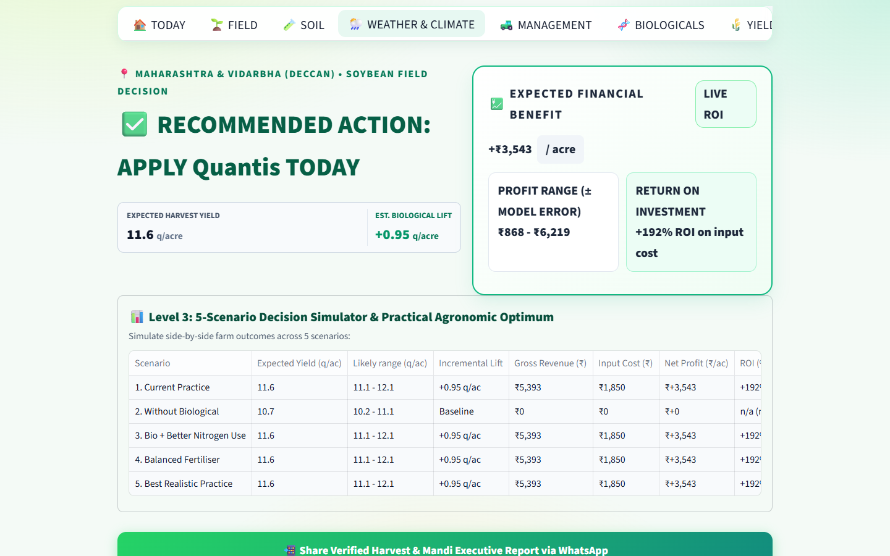
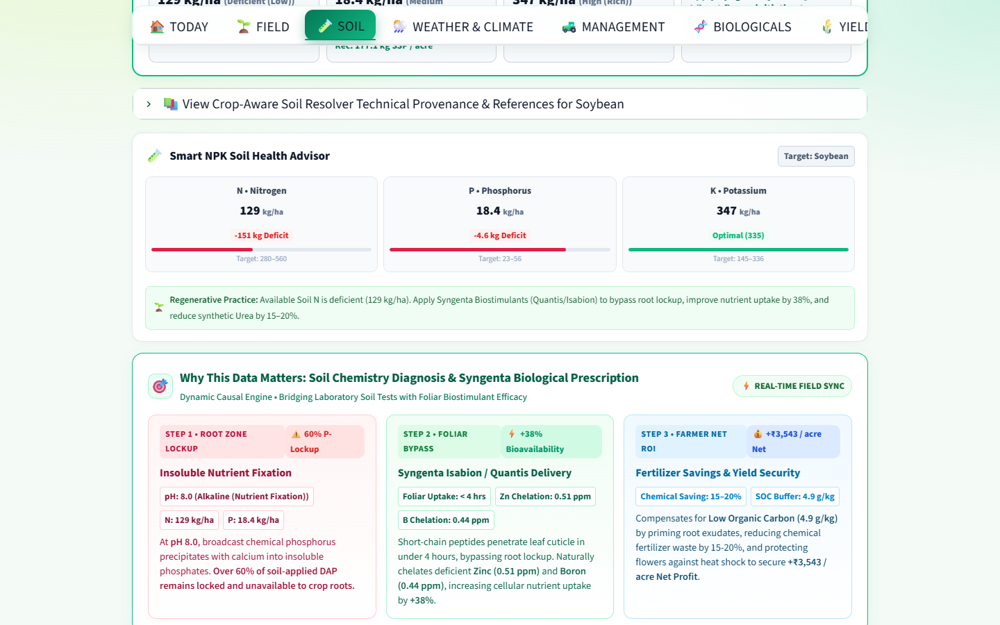
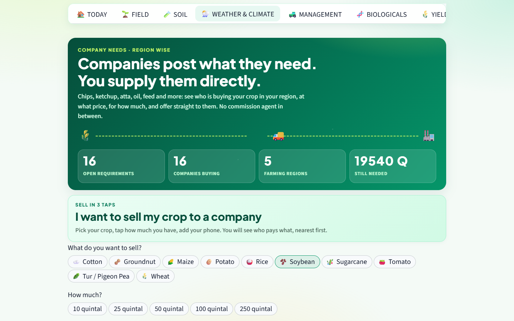
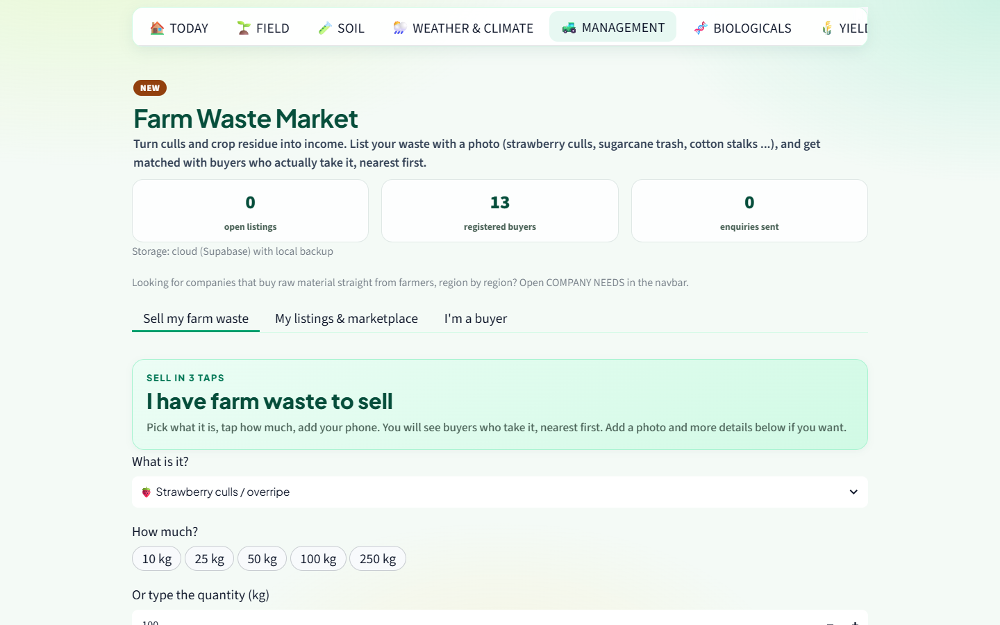
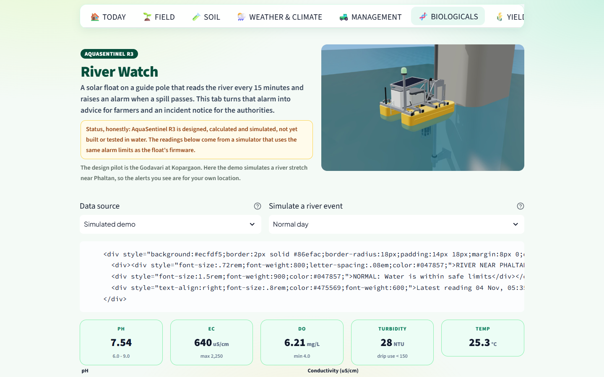
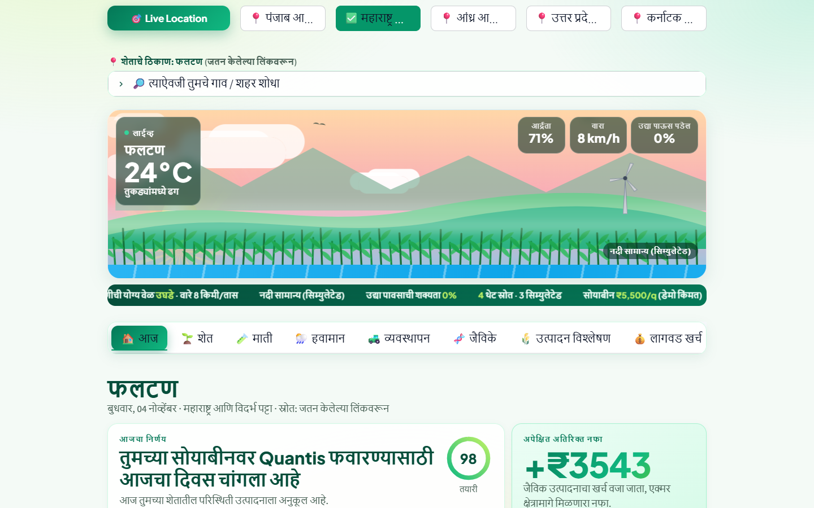

# AgriAttribute AI

[](https://github.com/college-hack24-nov26/hack-agriattribute-ai/actions/workflows/tests.yml)


**Yield attribution and ROI prediction for Indian farmers.** Know why your yield moved, what a biological input
actually earned you per acre, and where to sell, in your own language.

Team **HA097** · COEP Phaltan Hackathon 2K26 (PES) · Domain: AgriTech · Problem: *Yield Attribution and ROI prediction*
Bhakti Kadam ([@Bhakti2709](https://github.com/Bhakti2709)) · Soham Kadu ([@soham0777](https://github.com/soham0777))



### Explore it in 2 minutes

1. **Today** – the sky, wind and rain in the scene are the real weather at the farm's GPS point; one decision for today and the net ₹ per acre.
2. **Yield & attributes** – yield with vs without the biological, the SHAP waterfall, and a model card that states its own accuracy per crop.
3. **Impact & ROI** – raise the dose in Management and watch profit fall: extra product never adds yield, only cost.
4. **Company needs** – sell a crop to a company in 3 taps, nearest and best-paying first.
5. **River watch** – simulate a pollution event: an alert appears on every screen, in Marathi for the farmer and as a notice for the government.
6. Switch the language to **मराठी** (or any of 8 Indian languages) – the whole interface changes in under a second.

**Quick links:** [Application overview](docs/APP_OVERVIEW.md) · [Screens](#screens) ·
[Sources and why we use them](docs/SOURCES_AND_USE_CASES.txt) · [Audit and fixes](docs/AUDIT_RESPONSE.md) ·
[Deployment](docs/DEPLOYMENT.md)

**Live demo:** not public yet; runs locally with `streamlit run app.py` (see [Deployment](docs/DEPLOYMENT.md)).

> **Prior work.** This builds on our own prototype from Hack Core 2026 (Syngenta Biologicals × ANNAM.AI, PS-07).
> [`docs/AUDIT_RESPONSE.md`](docs/AUDIT_RESPONSE.md) lists what was audited and changed.

---

## The problem

A farmer sprays a biostimulant, gets a good harvest, and still cannot tell whether the product did it or the rain did.
Without that answer they either waste money on inputs that do nothing, or drop inputs that work. Then at harvest,
prices crash because everyone planted the same crop, and middlemen take the margin.

## What the app does

| Screen | What the farmer gets |
|---|---|
| **Today** | One decision for today (spray or wait), net ₹/acre, live weather scene, and a strip showing which numbers are live, snapshot or simulated |
| **Yield & attributes** | Predicted yield with a crop-specific error band, a SHAP waterfall (why the model says this), the with/without lift, and an honest model card |
| **Impact & ROI** | Five what-if scenarios priced with one formula (below), break-even lift, WhatsApp share and a PDF |
| **Field / Soil / Weather / Management / Biologicals / Cost** | Soil Health Card reference values, live OpenWeather and ANNAM.AI MCII stations, a practice form, a product matcher, a CACP-style cost sheet |
| **Company needs** | Region-wise board where companies post raw-material needs and farmers offer directly ("sell in 3 taps") |
| **Farm waste market** | Sell culls and residue to nearby buyers in 3 taps; optional Gemini photo check |
| **River watch** | AquaSentinel water-quality alerts for farmers (en/mr/hi) and a government action console |
| **AI chat** | Gemini assistant (text, voice, photo) grounded in the farm's numbers |

The whole interface is translated into Marathi, Hindi, Telugu, Tamil, Kannada, Gujarati, Bengali and Punjabi
(`services/i18n.py`, translations cached in `data/i18n/`). The navbar is hand-written; the rest is machine-translated
with Gemini, checked to be in the right script, and still needs a native-speaker review.

## The ROI formula (one place, unit-tested)

```
net return (₹/acre) = (treated yield − baseline yield) [q/acre] × mandi price [₹/q] − treatment cost [₹/acre]
treatment cost      = dose [L/acre] × product price [₹/L] + application labour [₹/acre]
ROI (%)             = net return / treatment cost × 100
```

`services/economics.py` holds it; `tests/test_economics.py` and `tests/test_scenarios.py` check it, including:
over-dosing never raises yield (the trials used one dose per crop, so extra product only adds cost), a negative
lift shows as a loss (never clipped to zero), fertiliser in kg/ha is priced per acre, and the error band is per crop.

## How far to trust the numbers

* **The training data is simulated.** `data/field_trials.csv` (1,600 paired plots, 12 crops, 8 regions) is generated by
  `pipeline/offline_training_pipeline.py`. It is not ICAR or company trial data.
* **Pooled R² (0.994) is misleading** because it mostly separates sugarcane (~380 q/acre) from mustard (~8 q/acre).
  Within each crop the held-out 2025 R² is **−0.27 to 0.69** and the typical error is **3–13 % of the crop's mean yield**.
  `python pipeline/evaluate_model.py` reproduces this and writes `models/per_crop_metrics.json`.
* **Lift check:** on held-out paired plots the model's with/without lift averages 7.50 vs 7.53 q/acre observed
  (pooled across crops, so still scale-dominated; per-crop lift errors are in the model card).
* **SHAP is not causation.** SHAP explains why the model predicts a number. The counterfactual lift is the model's
  estimate of the treatment effect. Proving cause needs real treated/untreated strips, which the Season Journal collects.
* **Inputs not measured for the farm** (season rainfall, GDD, NDVI) use the crop's season normal from the training data,
  labelled as such. Live temperature is clipped to the range the model was trained on.
* Mandi prices and MSP 2026-27 come from a bundled report snapshot, not a live feed. The assumed "quality premium" for
  treated produce is shown but never added to the ROI.
* Demo companies, buyers and river readings are fictional and marked **DEMO**. The platform introduces buyers and
  sellers; it does not hold money or verify companies.

Every source, how it is integrated and how far it is validated: Today tab → *Full source registry*
(`services/sources.py`).

## Screens

| Yield attribution (SHAP + with/without lift) | Model card (per-crop accuracy, stated limits) |
|---|---|
|  |  |
| **Impact & ROI (five scenarios)** | **Soil Health Card** |
|  |  |
| **Company needs: sell in 3 taps** | **Farm waste market** |
|  |  |
| **River watch (AquaSentinel)** | **Whole interface in Marathi** |
|  |  |

Architecture diagram and request flow: [docs/APP_OVERVIEW.md](docs/APP_OVERVIEW.md#4-architecture).

## Speed

Only the open tab runs (`st.tabs(on_change="rerun")` with `tab.open`), widget choices in closed tabs are kept
(`services/ui_state.py`), cloud reads are served from cache and refreshed in the background, downloads are built only
when clicked, and the quick-sell panels are fragments. On a laptop: first load ~7 s (models and caches), every tab
switch under 1 s, a re-run of the same tab ~0.2 s.

## Run it

```bash
python -m venv .venv
.venv\Scripts\activate            # Linux/macOS: source .venv/bin/activate
pip install -r requirements.txt
copy .env.example .env            # add your keys; every key is optional
streamlit run app.py
```

Without keys the app still runs: weather and stations fall back to cached values, storage to local JSON files,
the assistant to an offline rule engine. Gemini requests fall back across models when one is out of quota
(`GEMINI_MODELS` in `.env` overrides the list).

Tests and the model report:

```bash
pip install -r requirements-dev.txt
pytest -q
python pipeline/evaluate_model.py
```

Check every external service in one go (weather, sensor stations, Gemini, Supabase, maps, radar, geocoding):

```bash
python pipeline/check_services.py
```

Supabase tables: run `docs/supabase_schema.sql` and `docs/supabase_schema_v2.sql` once in the SQL editor.

## Layout

```text
app.py                      Streamlit entry point (navbar, shared field state, tabs)
services/
  economics.py              ROI, dose, unit conversion, season normals, per-crop error   <- the maths
  decision_simulator.py     5 scenarios, Mitscherlich optimum, TreeSHAP attribution
  field_context.py          one FieldContext feeding the model, ROI and every tab
  model_card_ui.py          per-crop accuracy, lift check, SHAP vs causal
  sources.py                live/snapshot/simulated strip and the source registry
  i18n.py                   whole-app translation layer (Gemini + cached JSON)
  ui_state.py               keeps widget values while their tab is closed
  gemini_service.py         assistant + shared Gemini caller with model fallback
  company_board_ui.py, direct_demand.py, quick_sell_ui.py   company needs board
  scrap_marketplace.py, scrap_market_ui.py                  farm waste market
  river_watch.py, river_watch_ui.py                         AquaSentinel alerts
  live_scene.py, today_ui.py                                Today screen
  ... weather, soil, mandi, cost, LeafVision, MCII, Supabase services
pipeline/
  offline_training_pipeline.py   generates the simulated trials and trains the model
  evaluate_model.py              per-crop metrics, lift check, season normals
  seed_translations.py           pre-translates the UI for all languages
models/                     model.pkl, feature schema, metrics, per-crop report, season normals
data/                       simulated trials, mandi snapshot, TNAU extracts, MCII cache, i18n caches
tests/                      unit tests for the ROI maths and the scenario simulator
docs/                       architecture, resources, source notes, audit response, SQL schema
assets/                     theme.css, product and leaf images, AquaSentinel renders
```

## Known limits (next steps)

* Re-train on real paired plots (Season Journal entries, KVK or company trials) and report per-crop accuracy again.
* Connect IMD rainfall, Sentinel-2 NDVI and SoilGrids instead of season normals.
* LeafVision is a colour and lesion rule screen with a rule score, not a trained classifier; replace with a model
  trained on PlantVillage-style data or a vision LLM, and calibrate it.
* Refresh the mandi snapshot from a live Agmarknet export.
* Build and field-test the AquaSentinel float.
