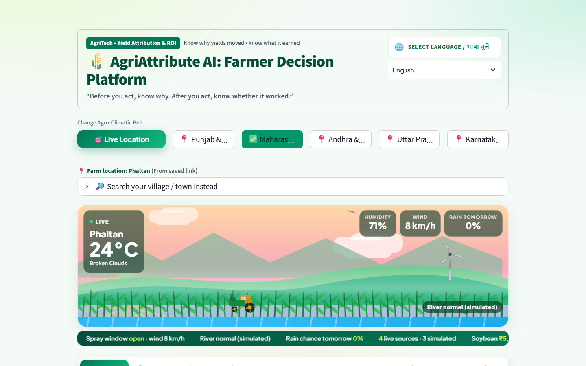
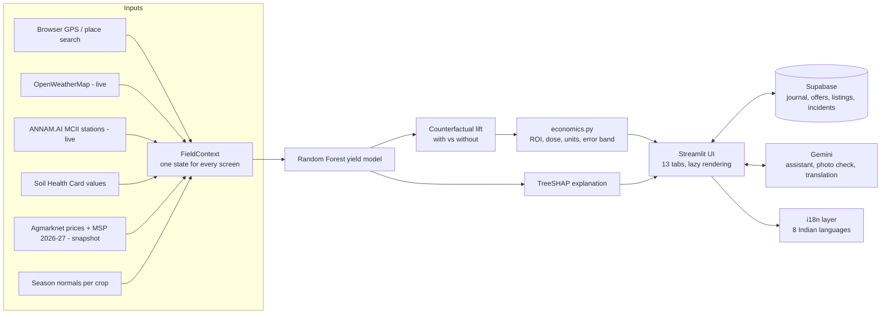
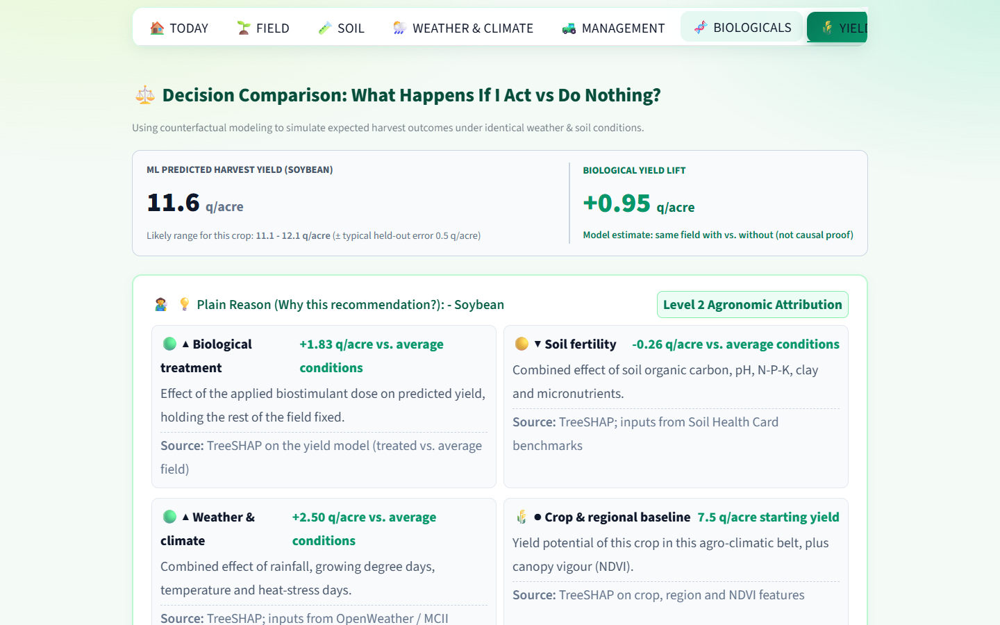
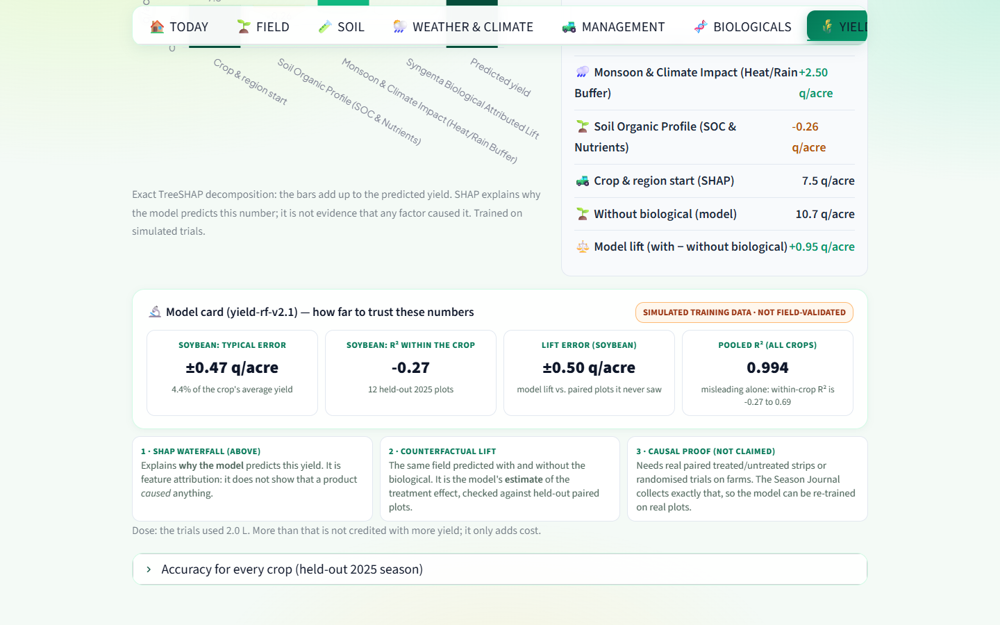
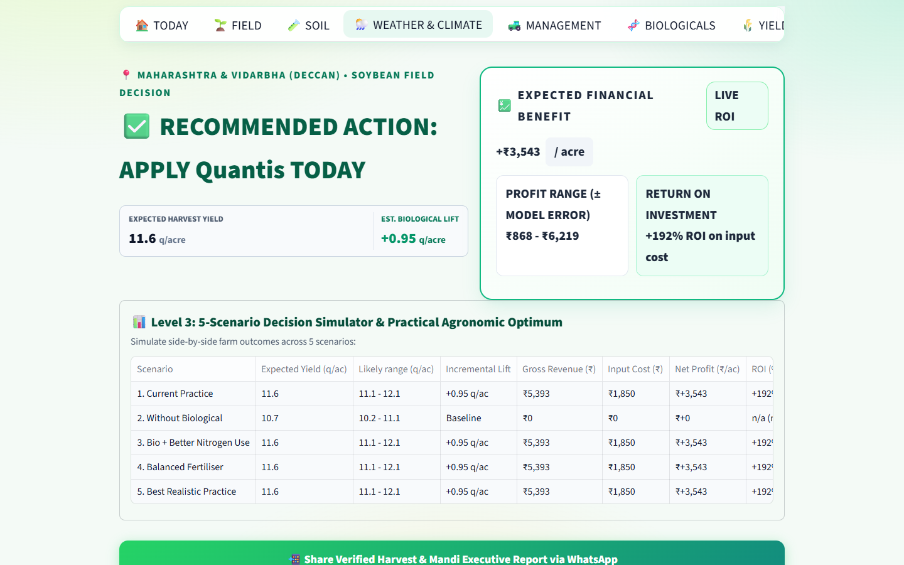
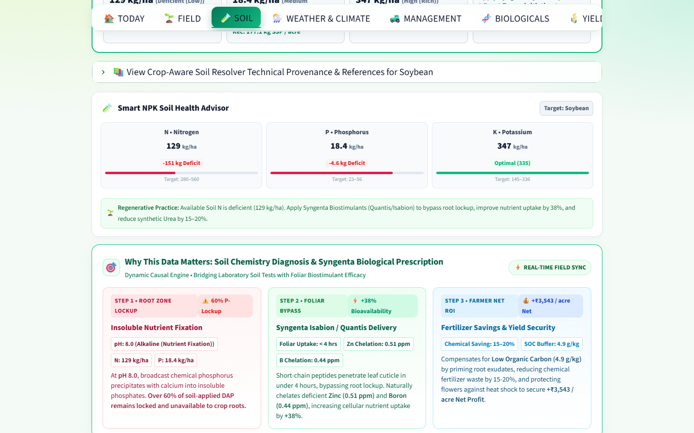
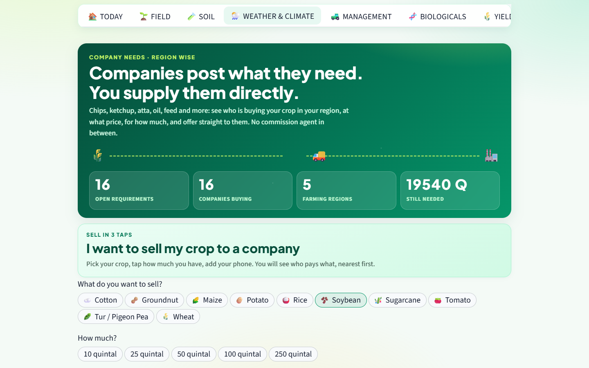
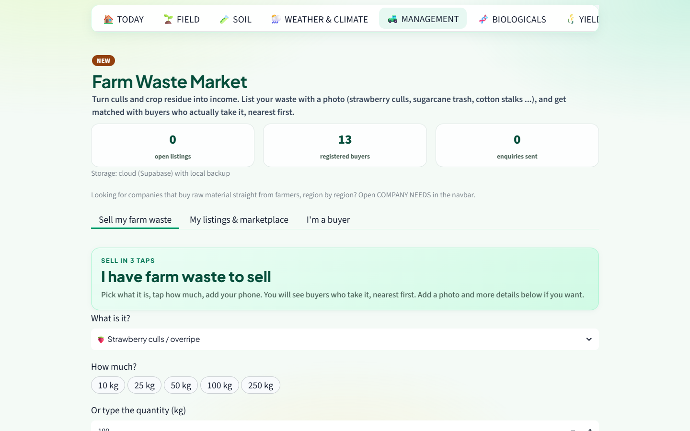
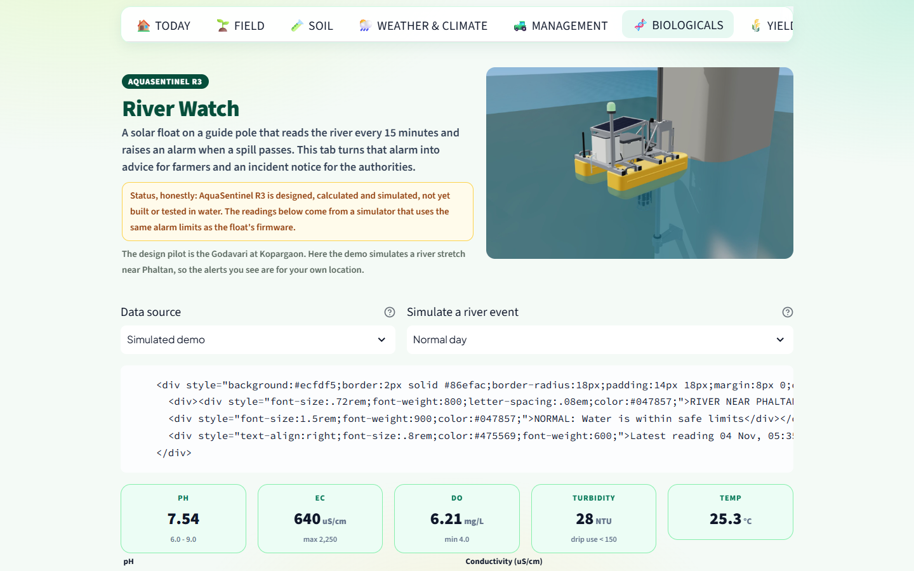
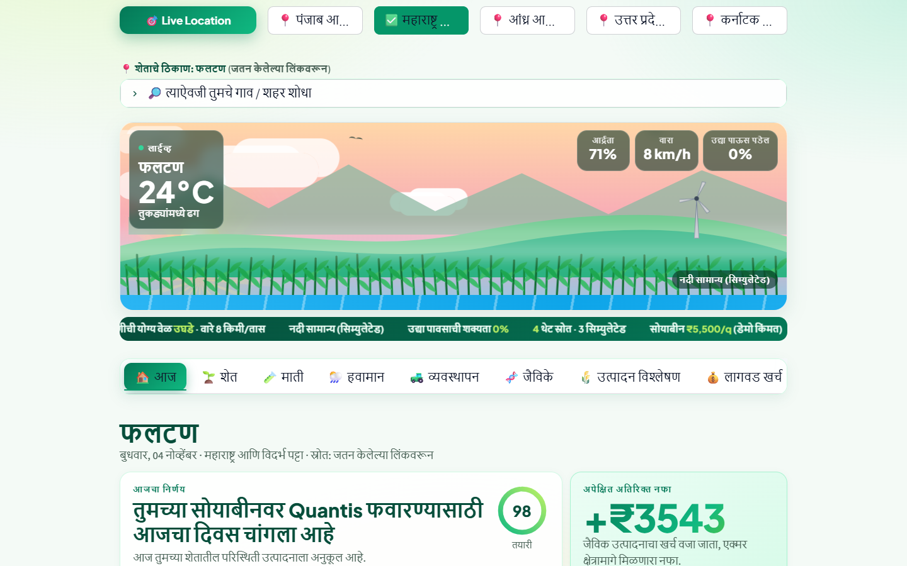

# AgriAttribute AI — application overview

> Team HA097 · COEP Phaltan Hackathon 2K26 · AgriTech · *Yield Attribution and ROI prediction*



## 1. The problem

An Indian farmer who sprays a biological input (a biostimulant or biofertiliser) cannot tell at harvest whether the
product raised the yield or the rain did. So money goes to inputs that may do nothing, or good inputs get dropped.
At harvest the same farmer sells into a crashed mandi through middlemen, and nobody warns them when the river that
irrigates the field is polluted.

## 2. The answer in one sentence

One mobile-first app that says, in the farmer's language, **what today's decision is, what a biological input really
earned per acre, and who will buy the crop or the waste**, while being open about which numbers are live, snapshot
or simulated.

## 3. What a farmer can do

| Need | Screen | How it works |
|---|---|---|
| "Should I spray today?" | **Today** | Live weather at the farm's GPS, wind and rain-tomorrow check, readiness score, net ₹/acre |
| "Did the product work?" | **Yield & attributes** | Model predicts yield with and without the product (counterfactual lift); TreeSHAP explains the prediction; honest per-crop accuracy |
| "Is it worth the money?" | **Impact & ROI** | Five scenarios priced with one tested formula; break-even lift; WhatsApp share; PDF advisory |
| "What does my soil need?" | **Soil**, **Management**, **Cost** | Soil Health Card reference values, fertiliser plan, practice log, CACP-style cost sheet |
| "Which product, when?" | **Biologicals** | Matches 19 products to crop, stage and stress, with label dose and per-acre cost |
| "Who will buy my crop?" | **Company needs** | Companies post raw-material needs by region; farmer offers in 3 taps; company accepts or declines |
| "Can I sell my waste?" | **Farm waste market** | Culls and residue to nearby buyers in 3 taps; optional AI photo check |
| "Is the river safe?" | **River watch** | AquaSentinel water-quality alerts for farmers (en/mr/hi) and a government action console |
| "I have a question" | **AI chat** | Gemini assistant by text, voice or photo, grounded in the farm's numbers |

Everything is available in **English, Marathi, Hindi, Telugu, Tamil, Kannada, Gujarati, Bengali and Punjabi**.

## 4. Architecture



**Request flow for one click:** the open tab's code runs (other tabs are skipped), the shared FieldContext is
reused unless region, crop, dose or location changed, cloud reads come from a cache refreshed in the background,
and text passes through the translation layer. A typical click takes about 0.2–0.9 s.

## 5. How the numbers are made

```
net return (₹/acre) = (treated yield − baseline yield) [q/acre] × mandi price [₹/q] − treatment cost [₹/acre]
treatment cost      = dose [L/acre] × product price [₹/L] + application labour [₹/acre]
ROI (%)             = net return ÷ treatment cost × 100
```

* The model was trained at one dose per crop, so it is always queried at that dose; the farmer's dose scales the
  credited lift (linear up to the trial dose, flat above) and the cost. Over-dosing never adds yield.
* The ± band is the held-out error for the selected crop, not one pooled number.
* 16 unit tests check this maths (`tests/`), and GitHub Actions runs them on every push.

## 6. Honest limits (shown inside the app as well)

| Item | Status |
|---|---|
| Training data | **Simulated** (1,600 paired plots); not real trials |
| Accuracy within a crop | R² −0.27 to 0.69; typical error 3–13 % of the crop's mean yield |
| Attribution | SHAP explains the model; the lift is a model estimate; causal proof needs real paired plots |
| Mandi prices | Bundled snapshot (Sep 2026), not a live feed |
| Satellite NDVI, IMD rainfall | Not connected yet (season normals, labelled) |
| Companies, buyers, river readings | Fictional demo entries marked DEMO |
| LeafVision | Rule-based screen with a rule score, not a trained classifier |
| Translations | Machine-translated and script-checked; navbar hand-written; needs native review |

## 7. Technology

Python · Streamlit 1.63 · scikit-learn (Random Forest) · SHAP · pandas / NumPy · Plotly · Leaflet ·
Google Gemini · Supabase (PostgreSQL) · OpenWeatherMap · ANNAM.AI MCII · OpenStreetMap Nominatim · fpdf2 ·
XlsxWriter · pytest · ruff · GitHub Actions · Docker.

## 8. Real-world impact (what changes for a farmer)

* Stops paying for inputs that do not pay back: the app shows the break-even lift and flags over-dosing.
* Decides spray timing from live wind and rain, so less product is wasted.
* Sells crop and waste directly to buyers in the same region, without a commission agent.
* Gets a river-pollution warning before irrigating, in their own language.

## 9. Screens

| | |
|---|---|
|  |  |
|  |  |
|  |  |
|  |  |

Sources and why each is used: [`SOURCES_AND_USE_CASES.txt`](SOURCES_AND_USE_CASES.txt) ·
Audit and fixes: [`AUDIT_RESPONSE.md`](AUDIT_RESPONSE.md) · Deployment: [`DEPLOYMENT.md`](DEPLOYMENT.md)
